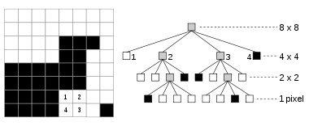

# Exercices ludiques en python

Vous trouverez ici un ensemble d'exercices permettant de pratiquer python mais également découvrir quelques pans annexes de l'informatique en général.
Ces exercices sont issus d'un livre réalisé par Pascal Lafourcade et Malika More.

## Exercice : Arbre quaternaire
Un quadtree ou arbre quaternaire (arbre Q) est une structure de données de type arbre dans laquelle chaque nœud a quatre fils. Les quadtrees sont le plus souvent utilisés pour partitionner un espace bidimensionnel en le subdivisant récursivement en quatre nœuds. 


Il existe plusieurs types de quadtree. Dans notre cas il s'agit d'un quadtree "region".
Le quadtree «région» représente une partition de l'espace en deux dimensions en décomposant la région en quatre quadrants égaux, puis chaque quadrant en quatre sous-quadrants, et ainsi de suite, avec chaque «nœud terminal» comprenant des données correspondant à une sous-région spécifique. Chaque nœud de l'arbre a exactement : soit quatre enfants, soit aucun (cas d'un nœud terminal).
Chaque `Noeud` comportant quatre éléments. Il s'agit d'une technique connue pour l'encodage d'images.  Pour simplifier, les images sont carrées, de couleur noir et blanc 
et de côté 2^n.

Un noeud à quatre fils est représenté : 
```python
from __future__ import annotations

class QuadTree:
    def __init(top_left: bool|QuadTree, top_right: bool|QuadTree, bottom_left: bool|QuadTree, bottom_right: bool|QuadTree):
        pass
    @property
    def depth(self) -> int:
        """ Recursion depth of the quadtree"""
        return 1
    @staticmethod
    def from_file(filename):
        # Your code here
        pass
    @staticmethod
    def from_list(data):
        pass 
    
    def paint(self):
        """ Textual representation of the QuadTree"""

class TkQuadTree(QuadTree):
    def paint(self):
        """ TK representation of a Quadtree"""
```

Assurez-vous que la lecture du fichier se passe sans encombre, en lançant les tests unitaires :
```shell
python -m pytest tests/test_quadtree.py -x
```

A partir du fichier `files/quadtree.txt`, générez le QuadTree associé. 
Puis, réalisez une interface graphique en utilisant la classe `TkQuadTree`, permettant de la représenter. 

Bonus : 
Faites le module inverse: A partir d'une image donnée, convertissez la en image noir et blanc, puis générez le fichier plat correspondant.


## Livraison :
Livrez votre projet via un dépôt git et communiquez l'url de votre dépôt au formateur. 
Vous pouvez adapter les tests ou les noms des méthodes, attributs en fonction de votre implémentation

## Barème :

- /1    Présence d'un fichier requirements.txt
- /1    Pertinence du fichier Readme.md
- /2    Gestion de GIT
- /2    Doctrings sur tous les modules, classes et méthodes
- /2	Nommage propre des méthodes/classes/variables
- /4	Le Quadtree est correctement généré
- /2    Absence de code superflu
- /2	Pertinence du code implémenté
- /2	Validation des tests et implémentation des tests unitaires additionnels pour couvrir toutes les fonctionalités
- /2	Interface graphique finie (TK, Pygame ou autre) et implémentation propre